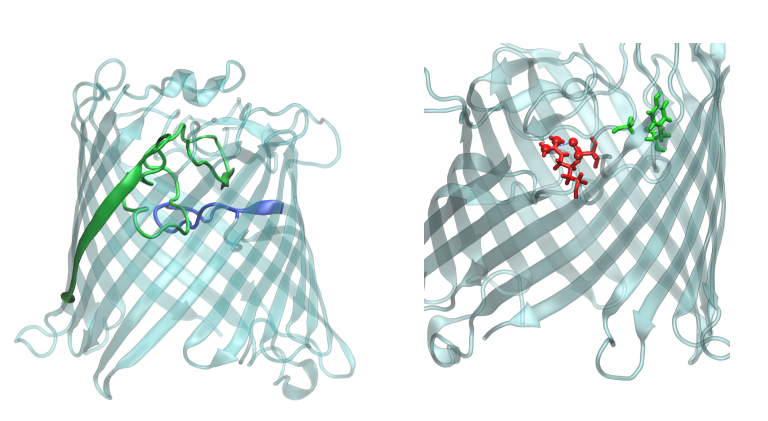
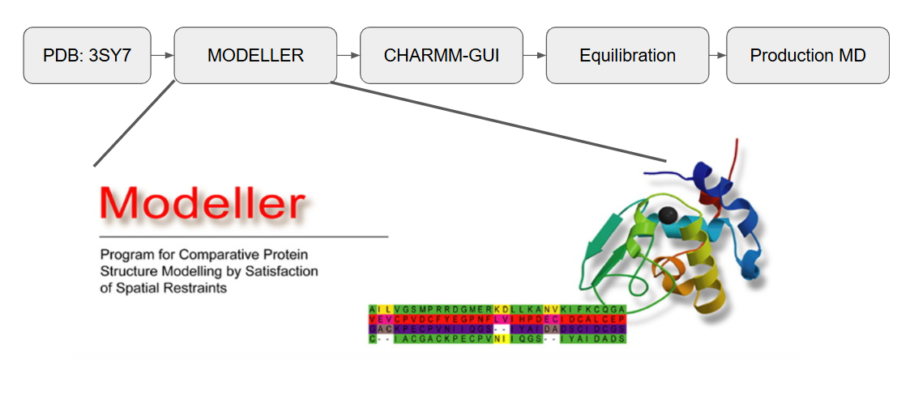
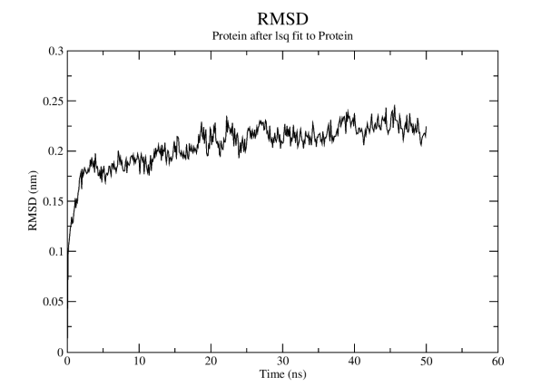
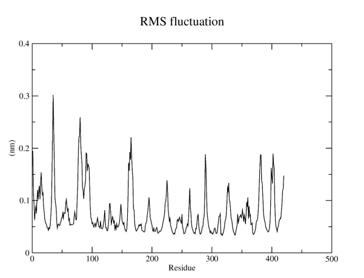
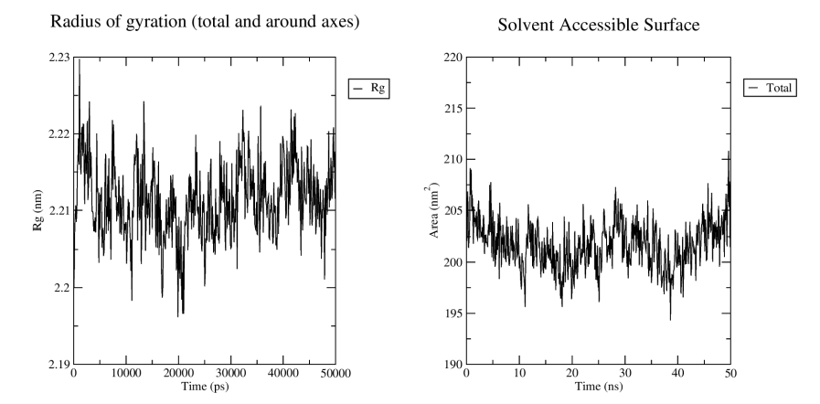
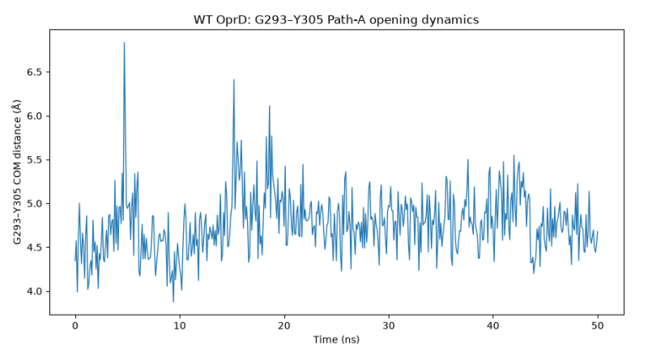
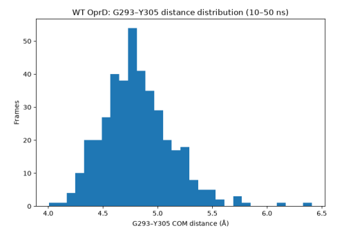
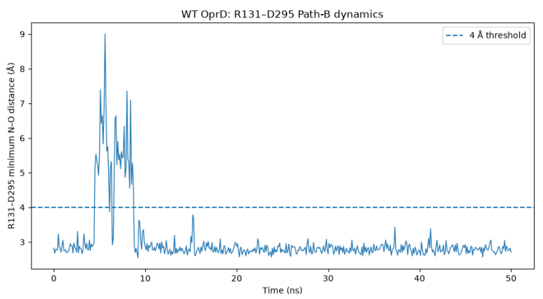
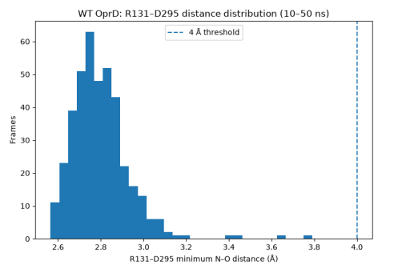

# Molecular Dynamics of Pseudomonas aeruginosa OprD

**Establishing an atomistic MD baseline for the OprD porin and its transport-related conformational dynamics**

The 50 ns OprD molecular dynamics trajectory video can be viewed here: **[`3SY7.mp4`](https://github.com/hydraharish123/oprD-AMR/blob/main/figures/3SY7.mp4)**.

## Overview

Antimicrobial resistance in Pseudomonas aeruginosa is multifactorial, with alterations in the outer-membrane porin OprD contributing to carbapenem resistance. This project uses molecular dynamics (MD) to establish a baseline for the structural and dynamic behaviour of native OprD before introducing meropenem and AMR-associated OprD variants.

In this project, one of the main questions that I asked was: **Can sequence variation in OprD produce molecular changes that could plausibly affect meropenem uptake?**

One major thing to note is that this project does not directly try to establish AMR. Instead, MD is used to investigate potential molecular mechanisms underlying altered porin function.

## oprD Protein Structure 

OprD (PA0958; also called OccD1) is a substrate selective outer-membrane beta-barrel porin that facilitates the uptake of basic amino acids and other small molecules. Importantly, OprD also provides a route for the uptake of carbapenem antibiotics. Loss or alteration of OprD is a well-established mechanism contributing to carbapenem resistance in P. aeruginosa.

The relationship between OprD sequence variation and antibiotic uptake is therefore particularly interesting at the molecular level. Structural and simulation studies have shown that OprD is not a rigid channel as movements of its internal and external loops contribute to the formation of distinct substrate-translocation pathways. In particular, loops L3 and L7 form part of the constriction region, while
interactions involving charged residues around the eyelet influence substrate passage. Another paper identified two structural descriptors associated with these transport-related conformational states: the R131–D295 distance, which characterizes the salt-bridge interaction controlling Path B, and the G293–Y305 center-of-mass distance, which was used to quantify opening of Path A.

  
  
<b>Figure 1</b>: Important structural components of oprD protein (3SY7) a. Loops L3
(residue 125 to 138) and L7 (residue 280 to 322) highlighted in green and blue
respectively. b. R131-D295 highlighted in red and G293-Y305 highlighted in
green

## Workflow 

  
  
<b>Figure 2</b>: Workflow of the oprD porin simulation (3SY7)

## Structure Preparation

Missing regions of the P. aeruginosa OprD structure were reconstructed via homology modeling in MODELLER 10.8 using the 3SY7 crystal structure as a template. While keeping the experimentally resolved coordinates fixed, 10 candidate models were generated and ranked by their DOPE scores. The top-scoring model—comprising all 420 residues and showing a C-alpha RMSD of ~0.57 Å across the 381 resolved template residues—was selected for molecular dynamics (MD) simulation.

## System & Simulation Parameters

| Parameter | Specification |
| :--- | :--- |
| **Protein** | *P. aeruginosa* OprD / OccD1 |
| **PDB ID** | `3SY7` (2.15 Å resolution) |
| **Model** | 420-residue OprD structure |
| **Membrane** | DMPC bilayer (Using CHARMM-GUI)|
| **Solvent** | TIP3P water |
| **Ions** | 0.15 M NaCl |
| **Ensemble** | NPT |
| **Temperature** | 303.15 K |
| **Timestep** | 2 fs |
| **Production MD** | 50 ns |
| **Trajectory Frequency** | 100 ps |

## Results

### Structural Stability

<table>
  <tr>
    <td align="center" width="50%">
      
       
      <b>(A) Backbone RMSD</b>
    </td>
    <td align="center" width="50%">
      
       
      <b>(B) Per-Residue RMSF</b>
    </td>
  </tr>
  <tr>
    <td align="center" colspan="2">
      
       
      <b>(C) Radius of Gyration (Rg) & SASA</b>
    </td>
  </tr>
</table>

<b>Figure 3</b>: Structural stability of wild-type OprD (3SY7) over a 50 ns MD simulation, showing (A) backbone RMSD, (B) per-residue RMSF, and (C) radius of gyration (Rg) and solvent-accessible surface area (SASA).

The OprD backbone remained structurally stable during the 50 ns production simulation with:

| Metric | Value |
| :--- | :--- |
| **Mean RMSD** | 0.206 nm |
| **Maximum RMSD** | 0.246 nm |
| **Mean RMSF** | 0.075 nm |
| **Mean Rg** | 2.211 nm |
| **Rg Range** | 2.196–2.230 nm |
| **Mean SASA** | 201.7 nm² |

The RMSF profile showed increased flexibility around residues 34–36, 78–81 and 163–165, which overlap with reconstructed regions and therefore require cautious interpretation.

### OprD constriction dynamics

The G293–Y305 centre-of-mass distance averaged 4.77 Å across the trajectory, with most observations during the 10–50 ns analysis window concentrated around 4.5–5.1 Å.

<table>
  <tr>
    <td align="center" width="58%">
      
       
      <b>(A) oprD Path A dynamics over time (0–50 ns)</b>
    </td>
    <td align="center" width="42%">
      
       
      <b>(B) Equilibrated Distribution (10–50 ns)</b>
    </td>
  </tr>
</table>

<b>Figure 4</b>: Constriction dynamics between G293 and Y305 in wild-type OprD (3SY7) over a 50 ns MD simulation, showing (A) distance time evolution (0–50 ns) and (B) post-equilibration distance distribution (10–50 ns).

---

The R131–D295 interaction was predominantly maintained after an initial transient disruption. The mean distance across the trajectory was approximately 3.05 Å, remaining below the operational 4 Å contact threshold in ~92% of frames.

<table>
  <tr>
    <td align="center" width="58%">
      
       
      <b>(A) oprD Path B dynamics over time (0–50 ns)</b>
    </td>
    <td align="center" width="42%">
      
       
      <b>(B) Equilibrated Distribution (10–50 ns)</b>
    </td>
  </tr>
</table>

<b>Figure 5</b>: Salt-bridge dynamics between R131 and D295 in wild-type OprD (3SY7) over a 50 ns MD simulation, showing (A) minimum N–O distance time evolution (0–50 ns) and (B) post-equilibration distance distribution (10–50 ns) relative to the 4 Å threshold.

These measurements provide a baseline for the conformational behaviour of the native OprD constriction region.

## Future Directions 

The next phase will introduce meropenem into the OprD system to characterize drug–porin contacts, hydrogen bonding, and drug positioning within the pore. Subsequently, an AMR-associated OprD variant will be simulated and compared with the native protein to investigate whether sequence variation alters porin dynamics or meropenem interactions. These comparisons may provide a molecular hypothesis for altered OprD-mediated antibiotic uptake, although experimental validation would be required to establish functional effects on resistance.

## References

1. Eren et al. Toward understanding the outer membrane uptake of small molecules by Pseudomonas aeruginosa. JBC, 2013.
2. Samanta et al. Molecular basis of substrate translocation through the outer membrane channel OprD of Pseudomonas aeruginosa. PCCP, 2015.
3. Laborda et al. Carbapenem-resistance oprD mutations reshape Pseudomonas aeruginosa host-pathogen interactions during infection. Nature Communications, 2026.
4. Whole-Cell-Based Assay To Evaluate Structure Permeation Relationships for Carbapenem Passage through the Pseudomonas aeruginosa Porin OprD. ACS Infectious Diseases, 2016.

